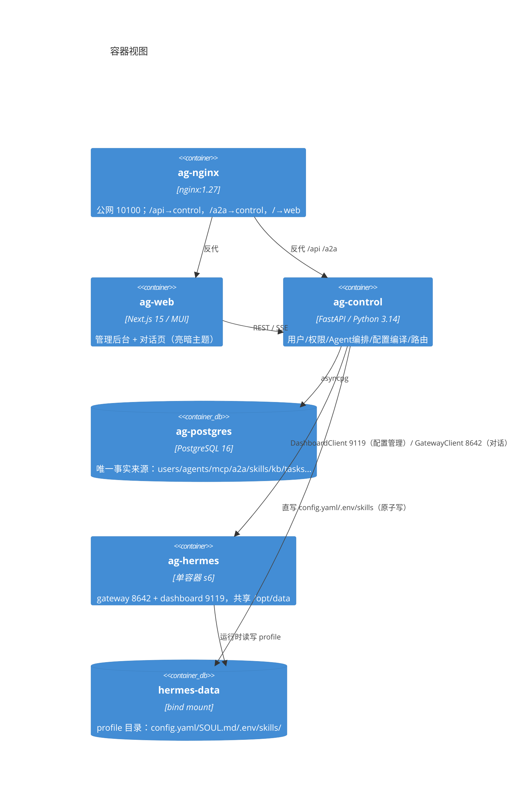

# 架构（模块边界 + C4 context/container）

事实来源见 [specs/](specs/)；现状见 [STATUS.md](STATUS.md)。

## C4 Context（系统上下文）

```mermaid
C4Context
    title agent-gateway 系统上下文
    Person(user, "用户 / 管理员", "在 Web 配置 Agent、对话；其他 Agent/系统通过 API 调用")
    System(gw, "agent-gateway", "多 Agent 管理平台（控制层 + Web）")
    System(hermes, "Hermes Agent", "LLM 运行时：推理 / 工具 / 会话 / Skill / MCP / A2A")
    SystemExt(llm, "LLM 服务", "Gemini / Claude / OpenRouter 等")
    SystemExt(rag, "RAGFlow", "外部知识库（可多站点）")
    SystemExt(cn, "IM 平台", "Telegram / 飞书 / Slack（连接器长连接）")

    Rel(user, gw, "HTTPS/HTTP: 管理 / 对话 / v1 API / A2A")
    Rel(gw, hermes, "内网: 9119 dashboard API + 8642 gateway API")
    Rel(hermes, llm, "模型调用")
    Rel(hermes, rag, "retrieve（MCP 工具，多站点路由）")
    Rel(hermes, cn, "长连接收发消息")
```

## C4 Container（容器/进程边界）



**关键事实**：`ag-control` 与 `ag-hermes` 以相同 uid:gid（1002:1003）运行，才能共同写 hermes-data（见 [decisions/](decisions/)）。

## 模块边界

### 控制层 `control/app/`

| 层 | 目录/文件 | 职责 | 不负责 |
|---|---|---|---|
| 入口 | `main.py`, `config.py`, `database.py` | lifespan、路由注册、引导管理员、session factory | 业务逻辑 |
| 接口 | `routes/*.py` | REST/SSE 端点、鉴权、归属校验 | 直接拼 hermes 配置细节（经 hermes/ 层） |
| 安全 | `security.py` | JWT(sub/role)、CurrentUser、can_modify | 权限策略之外的业务 |
| 数据 | `models.py` | ORM 表（17+ 张） | 迁移（项目策略为丢弃重建 + 显式 DDL） |
| **桥接** | `hermes/` | **配置编译 + Hermes 客户端**（bug 高发区） | LLM 推理 |
| 调度 | `scheduler.py`, `task_runner.py` | 定时任务扫描与执行、结果投递 | — |
| 连接器 | `connectors/` | Telegram/飞书/Slack 长连接 → on_message | webhook |

`hermes/` 关键文件：
- `provisioner.py`：profile 创建/命名/`apply_disabled_toolsets`/`ensure_profile_api_key`
- `toolsets.py` / `toolset_forcing.py`：默认禁用集；绑定资源后强制开启的 toolset
- `mcp_sync.py` / `a2a.py` / `skill_sync.py` / `rag_sync.py` / `rag_env.py`：把平台配置写进 profile 的 `mcp.servers` / `a2a_agents` / `skills/` / `.env`
- `client.py`（dashboard 9119）/ `gateway.py`（gateway 8642，profile 路由 + 专属 key）
- `chat_proxy.py` / `conversations.py`：SSE 翻译、会话归属
- `ragflow_mcp_server.py` / `ragflow_ingest.py`：内置 RAGFlow MCP、定时写入

### 前端 `web/src/`

- `app/admin/*`：管理后台（Agent/MCP/A2A/Skill/知识库/连接器/用户/ApiKey/任务）
- `app/chat/*`：对话页（轻量导航）
- `components/`：`AdminShell`（侧栏）、`ToolsetGrid`、`AuthFields`、`ChangePasswordDialog` 等
- `lib/api.ts`（接口类型与请求）、`authGuard.tsx`、`theme.tsx`（亮暗）、`sse.ts`/`sseStream.ts`（SSE 解析）、`clipboard.ts`

## 数据流两条主线

**A. 配置下发（写）**：前端保存 → `routes/*` → `hermes/*_sync` → profile 文件（config.yaml/.env/skills）。DB 是唯一事实来源，变更即整体重写对应段。

**B. 对话（读）**：请求 → 鉴权 → 定位 Agent → `profile_of_conversation` → `GatewayClient.chat_stream(profile=...)` → Hermes `/p/{profile}/api/sessions/...` → LLM + 工具 → SSE 翻译 → 前端。

对外 A2A 复用 B 的执行链路，用 `AgentAPIKey` 鉴权，仅已发布 Agent 可调用。
